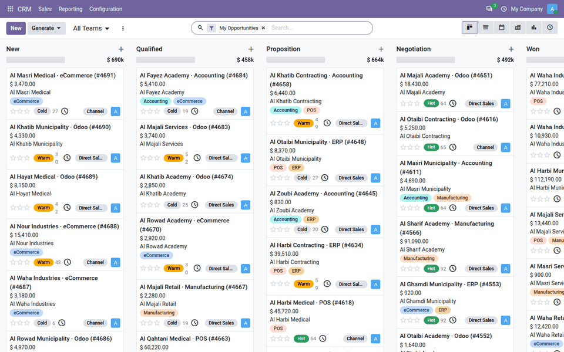
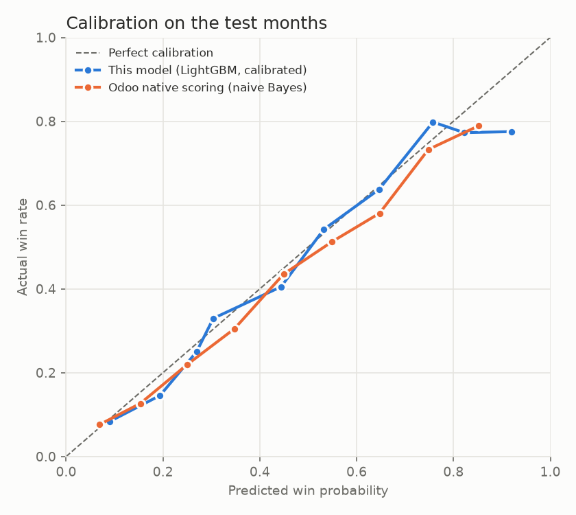
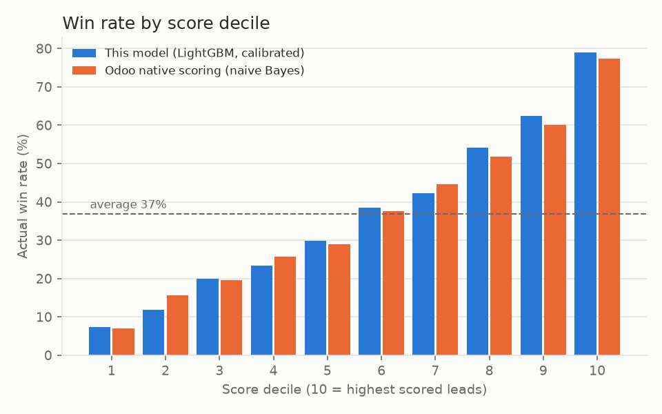
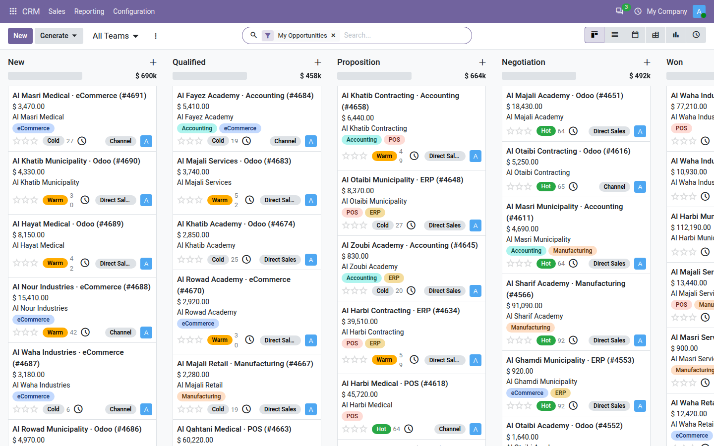
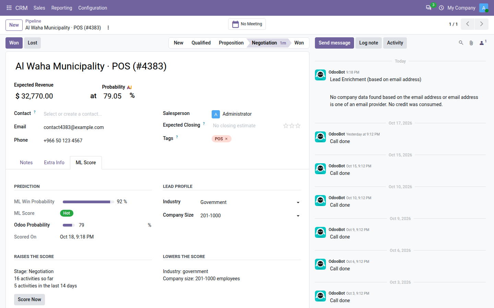
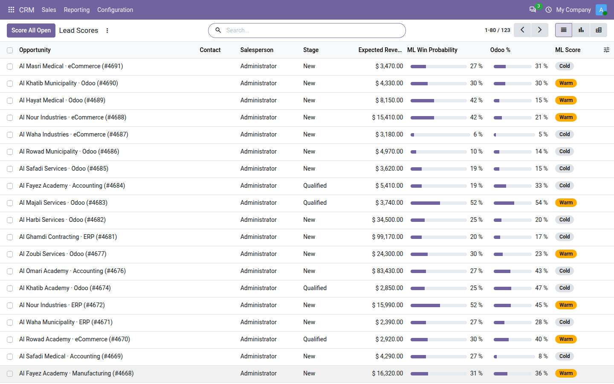
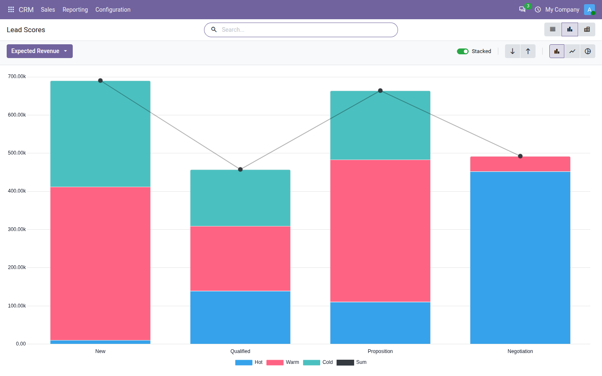

# CRM Lead Scoring for Odoo 20

An explainable win probability for every open CRM opportunity in **Odoo 20**:
- a calibrated percentage
- a band (hot, warm or cold)
- the main reasons that raise or lower it

It is computed by a LightGBM model behind a small FastAPI service and refreshed daily. It is shown **next to Odoo's
own predictive lead scoring** so the two can be compared.

> **The short version of the results:** on synthetic data, the model is better calibrated, ranks brand-new leads
> better, and explains every score. But it is **not reliably better than Odoo's built-in scoring at ranking leads
> overall**. The difference is within statistical noise. Odoo's native scoring is a strong baseline, and this README
> shows exactly where each one wins.



## How Odoo 20 scores leads natively

Read from `addons/crm/models/crm_lead.py` (`_pls_*` methods).

**Method:** a naive Bayes model, kept separately for each sales team. It counts won and lost leads for each value of
a few fields:
- phone and email quality
- state, country, source and language
- tags (ignored when a tag has fewer than 50 closed leads)
- stage: a won lead counts for every stage; a lost lead counts for its stage and all earlier ones

It adds 0.1 to every count, then computes P = S(won) / (S(won) + S(lost)).

This project re-implements it in Python (`OdooNaiveBayes` in `features.py`), so it can be evaluated offline. The
re-implementation was checked against a real Odoo 20 database: for all 123 demo leads it produced **exactly**
Odoo's own `automated_probability` (difference 0.0 points).

## Results

The data is a synthetic CRM history: 5,379 leads over 24 months, a 23% win rate, and dated stage changes and
activities (see [Data](#data)).
- The split is by lead creation date. Training covers months 1–14, calibration months 15–17, and test months 18–21.
- Leads created in months 22–24 are excluded, because many are still open.
- Each lead is scored at several points in its life: when it is created, when it enters each stage, and every
  14 days after that. Each score uses only what was known that day.

| Test months: 2,554 scoring points, 853 leads | ROC-AUC | PR-AUC | Brier | Calibration error | Win rate in top 20% vs average |
|---|---|---|---|---|---|
| Win rate of the current stage | 0.684 | 0.532 | 0.206 | 0.012 | 1.68× |
| **Odoo 20 native scoring** (naive Bayes) | 0.754 | 0.632 | 0.191 | 0.033 | 1.87× |
| **This model** (LightGBM + isotonic calibration) | **0.767** | **0.633** | **0.187** | 0.030 | **1.92×** |

| Brand-new leads only (day 0, 853 leads) | ROC-AUC | PR-AUC | Win rate in top 20% vs average |
|---|---|---|---|
| Odoo 20 native scoring | 0.709 | 0.381 | 1.79× |
| This model | **0.729** | **0.389** | **2.06×** |

- **Model minus Odoo, ROC-AUC: +0.013**, with a 95% interval from −0.010 to +0.035. This comes from 1,000
  bootstrap resamples of whole leads, because one lead's scoring points are correlated. **The interval includes
  zero.**
- **Where the model clearly helps:**
  - ranking brand-new leads, which is where prioritising matters most
  - calibration: when it says 70%, about 70% win (see the chart)
  - explanations for every lead
- **Why Odoo does so well here:** the generator builds a lead's hidden quality by *adding* independent effects per
  attribute. That is exactly the assumption naive Bayes makes, so this data favours it. Real CRM data, with
  interactions between attributes, may favour the gradient-boosted model more. That is untested.





**Most important features** (share of LightGBM gain):
- stage 25%
- source 13%
- activity count 9%
- expected revenue 8%
- company size 8%
- industry 7%
- recent activity 6%
- email quality 6%

## The leakage trap

The most common way to build lead scoring is also the wrong one:
1. Take the closed leads.
2. Use their final values: the stage reached, the total number of activities, the days until closing.
3. Split the rows at random.

Done that way on this data, the model scores **ROC-AUC 1.000**: perfect. It is useless, because none of those
values exist while a lead is still open. A lead's final stage tells you whether it was won.

This project avoids it in two ways:
- **Training rows are snapshots** of each lead *as it was on the scoring day*. They come from dated stage changes
  and dated activities, and every snapshot is taken strictly before the lead closed (a test checks this).
- **The split is by date and by lead**, never by row, so one lead's snapshots never appear in both training and
  test.

## Inside Odoo

Module `addons/crm_ml_score` (Odoo 20 Community, depends on `crm`).

**What a user sees:**
- **Opportunity form, *ML Score* tab:**
  - the ML probability and band
  - Odoo's own probability, side by side
  - "Raises the score" and "Lowers the score" lists, for example "Source: referral", "7 activities so far",
    "No phone"
  - a *Score Now* button
- **Kanban cards:** a hot/warm/cold badge with the percentage.
- ***CRM → Reporting → Lead Scores*:** a list (ML % next to Odoo %), plus a pipeline graph and pivot by band and
  stage.

| Pipeline: a Hot / Warm / Cold badge on every card | Opportunity: ML score next to Odoo's probability, with reasons |
|---|---|
|  |  |
| **Lead Scores: ML % next to Odoo %** | **Open pipeline value by score band and stage** |
|  |  |

The screenshots are taken automatically from the Docker demo: `make reset-demo && make e2e && make screenshots`.

**How it works:**
- **Two new fields:** *Industry* and *Company Size*. The model uses them, and standard CRM does not record them.
- **Daily refresh:** a scheduled action rescores all open opportunities, and *Score All Open* does it on demand.
  If the service is down, the job logs a warning and continues; the buttons show a clear error.
- **Activities:** completed activities are read from the messages Odoo posts when an activity is marked done.
- **Source names** are normalised: "Cold Call" → `cold_call`, and "Referral [2]" → `referral`.

**End-to-end check** (`scripts/e2e_check.py`, run locally and in Docker):
1. The demo loads 4,568 closed leads, which Odoo's native scoring learns from.
2. It loads the 123 leads that were open on a cutoff day, with their real history, and shifts all dates so the
   cutoff is today.

Results:
- **Consistency:** the scores computed through Odoo equal the offline scores for all 123 leads (largest
  difference 0.0). Training and live scoring use identical features.
- **Accuracy:** on those 123 leads, the real outcome gives the model ROC-AUC 0.776 and Odoo's native scoring
  0.769. That is a small sample, consistent with the test set.

## Run it

```bash
make demo   # builds, trains (about 1 min), creates database "demo", loads the CRM history, scores, runs the check
```
- Odoo: http://localhost:8071 (admin / admin) → *CRM → Reporting → Lead Scores*
- Service: http://localhost:8002/docs
- MLflow: http://localhost:5002

The ports differ from the other portfolio projects, so all stacks can run together.

Without Docker:
```bash
cd ml && python -m venv .venv && . .venv/bin/activate && pip install -e ".[dev,mlflow]"
python -m crm_score_ml.generator && python -m crm_score_ml.train && python -m crm_score_ml.charts models/latest ../docs
uvicorn crm_score_ml.service:app --port 8002
```

Tests: `pytest` in `ml/` (5 tests, including the snapshot leakage check), and the Odoo module tests:
`odoo-bin -i crm_ml_score --test-tags /crm_ml_score`.

## Data

All data is synthetic, from `ml/src/crm_score_ml/generator.py`. No real company or customer data is used.

Each lead has visible attributes:
- source, country, industry, company size
- email and phone quality, language, tags
- expected revenue, team

Each lead also has a **hidden quality** that the model never sees. Most of that hidden quality is random noise, so
no model can be near-perfect.

Leads move New → Qualified → Proposition → Negotiation → Won, or are lost at any stage:
- Faster first contact and more engaged prospects (more activities) win more often.
- Salespeople differ in how quickly and how often they follow up.

**Why synthetic?** Public lead-conversion datasets do not look like Odoo CRM data, and this project was built
offline.

## Limitations

- **Synthetic data with additive effects.** It probably favours naive Bayes, and real-world accuracy is
  unmeasured. The honest claim is "comparable to Odoo's native scoring, better calibrated, explainable", not
  "better".
- **The model is trained on the synthetic history, not on the company's own leads.**
  - A real deployment should retrain on the company's closed leads.
  - That needs dated history from Odoo (stage tracking and activity messages) to rebuild leakage-free snapshots.
  - That is the obvious next step, and it is not built yet.
- **The categories are fixed** (sources, industries, sizes, countries). Values the model has not seen are treated
  as missing, and countries outside the list as "Other".
- **The end-to-end comparison uses only 123 leads.**

## License

LGPL-3.0. See [LICENSE](LICENSE).
